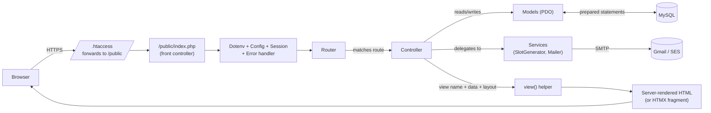

# Slate

> A booking appointment system built from scratch in vanilla PHP 8.2 — no framework, no calendar library, no build step. Editorial typography on a calm cream-and-terracotta palette. Custom split-view calendar, race-safe slot booking, transactional emails, admin panel with notes auto-save, full security pass. Built to prove that a small business app can feel premium without bringing along React, Node, or Laravel.

[](https://www.php.net/)
[](https://www.mysql.com/)
[](https://getbootstrap.com/)
[](https://alpinejs.dev/)
[](https://htmx.org/)
[](LICENSE)

**[Live demo →](#)**  ·  **[Case study →](docs/CASE_STUDY.md)**  ·  **[Security notes →](SECURITY.md)**  ·  **[Deployment guide →](DEPLOYMENT.md)**

---

## Screenshots

| | |
|---|---|
|  |  |
| **Landing page** — editorial hero with an animated mini-calendar. | **Booking calendar** — 40/60 split, slot cards stagger in. |
|  |  |
| **Booking form** — floating labels, debounced terms checkbox, loading spinner state. | **Admin dashboard** — stat cards with serif numerals, no icons inside. |
|  |  |
| **Admin appointments** — list / calendar views with slide-in detail panel. | **Confirmation email** — table-based HTML, plain-text alternate, GCal link. |

*(Replace these with your own captures — see [Suggested screenshots](#suggested-screenshots-for-your-portfolio) below.)*

---

## Features

- **Custom split-view booking calendar** — server-rendered grid, HTMX month-swap animation, full keyboard navigation (`role="grid"`, arrow keys), with availability dots per service.
- **Race-safe slot booking** — concurrent attempts on the same slot are serialised via `SELECT ... FOR UPDATE` inside a transaction. Second customer gets a friendly *"that slot was just taken"* and the chance to pick again.
- **Transactional email lifecycle** — confirmation, cancellation, reschedule (with strikethrough old time), 24h reminder via cron, admin notification on every new booking. HTML + plain-text alternates, table-based for Outlook safety.
- **Timezone-aware throughout** — business timezone read from `settings`, applied consistently across the slot generator, SQL queries, emails, and Google Calendar export links (which convert to UTC explicitly).
- **Admin panel** — Today / Upcoming / All / Calendar views, search by name/email/reference, debounced notes auto-save, CSV export matching current filters, three-dot action menu (mark completed / no-show / cancel / resend email).
- **Production-grade security** — file-based IP rate limiting, CSRF on every POST, Argon2id passwords, prepared statements only, full security header stack (CSP, HSTS, XFO, XCTO, Referrer-Policy). [See SECURITY.md](SECURITY.md).
- **Polish layer** — fade-on-scroll sections, slide-in slot cards, skeleton screens, top progress bar, prefers-reduced-motion respect, AA-contrast colour pairs, skip-to-content link.
- **No build step** — the source tree IS the deployable artifact. `composer install` and you're done.

---

## Architecture



A single front controller, a tiny PSR-4-autoloaded router, fat-but-honest controllers, dumb models, and two domain services. The view layer is plain PHP files captured with `ob_*` and stitched into a layout. No magic.

---

## Tech stack

| Layer        | Choice                                          | Why |
|---|---|---|
| Language     | PHP 8.2 (`readonly`, enums, named args)         | Modern, expressive, no compilation. |
| Database     | MySQL 8 / MariaDB 10.5+ via PDO                 | Ubiquitous on shared hosting. |
| Dependencies | `vlucas/phpdotenv`, `phpmailer/phpmailer`, `nesbot/carbon` | Three deps. That's the whole list. |
| UI base      | Bootstrap 5.3 (heavily overridden)              | Reset + grid utilities; design system on top. |
| Interactivity| HTMX 1.9 + Alpine.js 3                          | Server-rendered HTML with sprinkles of state. |
| Fonts        | Inter (body), Fraunces (display)                 | Both via Google Fonts. |
| Icons        | Lucide                                          | Single SVG sprite, hand-picked per page. |

---

## Quick start

### Option 1 — Docker (one command)

```bash
git clone https://github.com/yourhandle/slate.git
cd slate
docker compose up --build
# open http://localhost:8080
```

The MySQL service auto-loads `schema.sql` and `seed.sql` on first boot. Admin login is `admin@slate.test` — regenerate the password hash first with `php database/seeders/make_admin.php "yourpass"` and paste it into `seed.sql` before the first `compose up`.

### Option 2 — Local PHP + MySQL

```bash
git clone https://github.com/yourhandle/slate.git
cd slate
composer install
cp .env.example .env
# edit .env with your DB credentials and Gmail App Password

# create the database, then:
mysql -u root -p slate < database/schema.sql
mysql -u root -p slate < database/seed.sql

# point your web server's document root at /public
# (built-in dev server works too:)
php -S localhost:8000 -t public
```

Visit `http://localhost:8000`. Sign in as `admin@slate.test` (see seed.sql for the password).

---

## Folder structure

```
slate/
├── app/
│   ├── controllers/
│   │   ├── admin/                   ← 7 controllers behind require_admin()
│   │   ├── AuthController.php       ← login, register, logout
│   │   └── BookingController.php    ← /book + /api/slots + /booking/{token}/*
│   ├── core/
│   │   ├── Database.php             ← PDO singleton, prepared statements only
│   │   ├── Router.php               ← {param}-aware, tiny
│   │   └── Validator.php            ← rule-based, optional
│   ├── helpers/functions.php        ← e(), view(), csrf_*(), flash(), redirect()…
│   ├── jobs/SendReminders.php       ← CLI + cron-job.org compatible
│   ├── middleware/RateLimit.php     ← file-backed, flock-safe
│   ├── models/                      ← 6 thin DAOs
│   ├── services/
│   │   ├── Mailer.php               ← PHPMailer wrapper, 5 templates
│   │   └── SlotGenerator.php        ← the heart of the booking engine
│   └── views/
│       ├── admin/                   ← dashboard, services, schedule, appointments, settings, email-test
│       ├── auth/                    ← login, register
│       ├── booking/                 ← split-view calendar, slot panel, form, confirmation, cancel, reschedule
│       ├── emails/                  ← shared layout + 5 HTML templates + 5 text alternates
│       ├── errors/                  ← 404, 429, 500
│       ├── layouts/                 ← main (public) + admin (sidebar)
│       └── home.php                 ← marketing landing page
├── config/                          ← app.php, db.php, mail.php (all read $_ENV)
├── database/
│   ├── schema.sql                   ← 7 tables, indexes, FKs, ENUMs
│   ├── seed.sql                     ← admin + 4 services + business hours + settings
│   └── seeders/make_admin.php       ← CLI to generate Argon2id hashes
├── docs/
│   ├── CASE_STUDY.md                ← portfolio narrative
│   └── screenshots/                 ← drop your captures here
├── public/                          ← web root
│   ├── assets/css/app.css
│   ├── favicon.svg
│   ├── index.php                    ← front controller
│   └── .htaccess                    ← pretty URLs + security headers
├── storage/
│   ├── cache/ratelimit/             ← JSON files, flock-locked
│   └── logs/                        ← php-errors.log in production
├── .env.example
├── composer.json
├── docker-compose.yml
├── Dockerfile
├── DEPLOYMENT.md
├── README.md
└── SECURITY.md
```

65 PHP files, ~5,200 lines of application code, three composer deps.

---

## Why these choices

### No framework

Laravel would have shaved 70% off the build time. The point of *this* project was the opposite: to **prove I understand what a framework does for me**. The Router, the Database singleton, the Validator, the Mailer, the view rendering helper — they're all hand-rolled. Each one is 50–200 lines and I can walk an interviewer through every line.

### HTMX over React

A React + Vite + Tailwind stack would have been the trendy choice. HTMX is the contrarian one — and the right one for a server-rendered booking flow. Zero build step. No hydration mismatch. SEO-friendly by default. Degrades gracefully when JS fails. Alpine.js handles the small pieces of true client state (modal open / closed, calendar selected date) that don't make sense as round-trips.

### Custom calendar

I could have dropped FullCalendar in 20 minutes. Building the calendar from scratch — server-rendered grid, HTMX-swapped month navigation, keyboard arrow-key support, `role="grid"` + `role="gridcell"` semantics, availability dot per day per service — was 6× the work. But the source code is now legible from first principles. That's a stronger portfolio signal than "I called `<FullCalendar />` with the right props."

The long-form version of all three lives in [the case study](docs/CASE_STUDY.md).

---

## Security

A separate, more thorough document: [SECURITY.md](SECURITY.md).

Headlines:

- **CSRF** — `csrf_check()` on every POST (header or POST field, `hash_equals()` comparison). 18/18 audit.
- **SQL injection** — 100% prepared statements via PDO with `ATTR_EMULATE_PREPARES = false`.
- **XSS** — every dynamic view output through `e()`; JSON embedded in attributes uses `JSON_HEX_*` flags + `htmlspecialchars()`.
- **Sessions** — `HttpOnly`, `SameSite=Lax`, `Secure` in production, `use_strict_mode`, 2-hour idle timeout for authenticated users.
- **Passwords** — Argon2id, NIST-style rules (8+ chars, ≥1 letter, ≥1 number, no composition silliness).
- **Rate limiting** — file-backed, IP-keyed, four endpoints with sensible windows.
- **Headers** — CSP, HSTS, X-Frame-Options, X-Content-Type-Options, Referrer-Policy, Permissions-Policy.

---

## Roadmap

- **Stripe payments** — services with `price > 0` flip to `status='pending'` until a checkout session succeeds. The `appointments.status` enum already includes `pending`; the integration point is marked with a `TODO: Stripe` comment in `BookingController::store()`.
- **Twilio SMS reminders** — the `Mailer` class abstracts dispatch; an `SmsService` would slot in alongside it and the `SendReminders` job would dispatch both.
- **Recurring appointments** — "every Tuesday at 3pm" via an `appointments.recurrence_rule` column + a cron-driven expansion job.
- **Multi-staff support** — add `staff_id` to services, appointments, and business_hours; the SlotGenerator gets an extra filter.
- **Public REST API** — `/api/v1/services`, `/api/v1/availability`, `/api/v1/bookings`, key-based auth. The Router supports it; just needs a JSON response helper and an `ApiController` namespace.
- **i18n** — externalize strings into `/lang/<locale>.php`; Carbon already speaks every locale.

---

## Suggested screenshots for your portfolio

Drop into `docs/screenshots/`:

| Filename | What to capture |
|---|---|
| `01-home-hero.png`         | Landing page, scrolled to top, slot pills mid-fade |
| `02-booking-calendar.png`  | `/book` with a date selected, slot cards visible |
| `03-booking-form.png`      | Form panel slid in, floating labels active |
| `04-admin-dashboard.png`   | `/admin` with the four stat cards |
| `05-admin-appointments.png`| `/admin/appointments` with the slide panel open |
| `06-email-confirmation.png`| A rendered confirmation email (Gmail or Mailtrap preview) |
| `07-mobile.png`            | iPhone-width view of `/book` |

---

## License

MIT. See [LICENSE](LICENSE).
